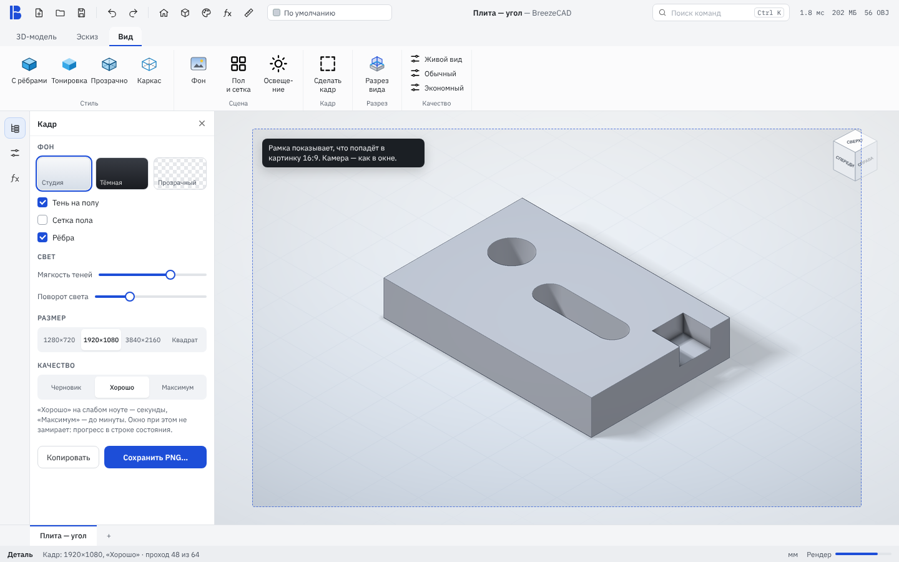
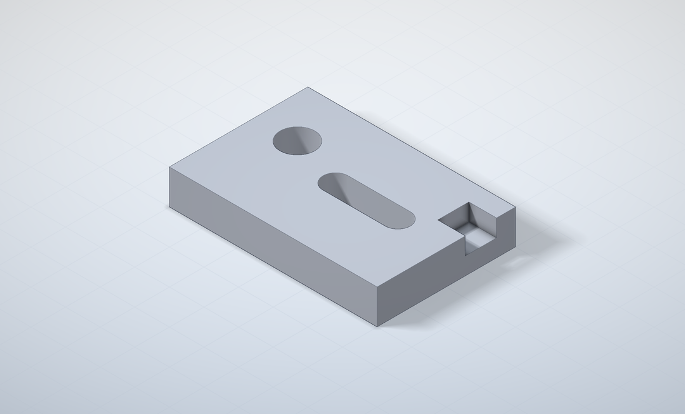
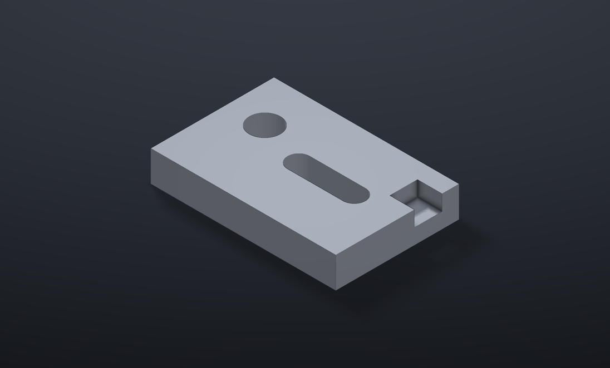
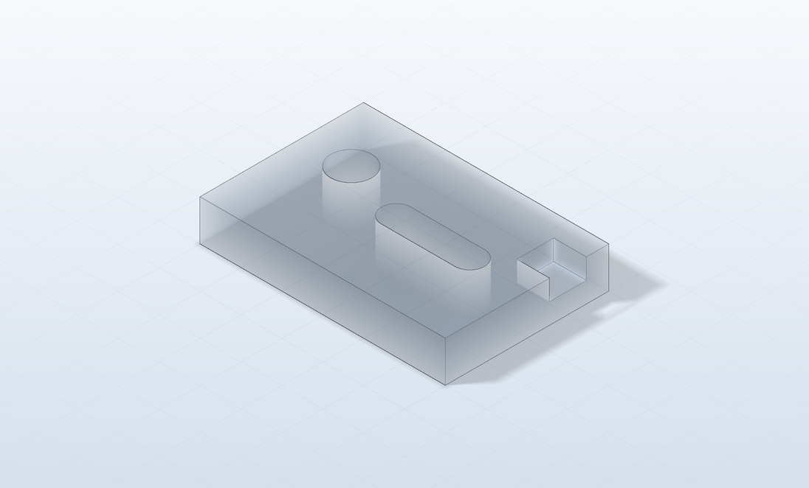

# «Кадр» — красивая картинка детали по кнопке

Статус: **макет на согласование**. Кода программы в ветке нет.

| Светлая студия | Тёмная студия | Поликарбонат |
|---|---|---|
|  |  |  |

(Превью посчитано прототипом из ветки `design/viewport-look`. Настоящий «Кадр» на трассировке путей OCCT даст мягче тени и
честные отражения.)

## Зачем

DIY-аудитория постоянно показывает свои детали: в чатах, на форумах, у слайсеров, на Бусти. Сейчас для этого нужен скриншот
окна или чужой рендерер. «Кадр» даёт картинку для поста за два клика, а заодно — картинки для сайта и промо BreezeCAD.

## Как работает

- Вкладка «Вид» → **«Сделать кадр»**. Слева открывается панель (окон поверх рабочей области нет, как и везде).
- Камера — как в окне. Рамка показывает, что попадёт в картинку при выбранном соотношении сторон.
- **Фон:** светлая студия / тёмная студия / прозрачный (PNG с альфой). **Тень на полу**, **сетка пола**, **рёбра** — флажки.
- **Свет:** мягкость теней, поворот света вокруг детали.
- **Размер:** 1280×720 / 1920×1080 / 3840×2160 / квадрат 1080 (для соцсетей).
- **Качество:** черновик / хорошо / максимум — это число проходов трассировки (16 / 64 / 256).
- Считается по частям, по несколько проходов за кадр: окно не замирает, прогресс — в строке состояния, Esc — отмена.
- «Сохранить PNG…» запоминает папку; «Копировать» кладёт картинку в буфер обмена.

## Как сделать

**В основе — одна команда.** Уже есть `view.snapshot` (`ViewCommands.cpp` → `Viewport::Snapshot` → `V3d_View::ToPixMap`).
Добавляется `view.render` с теми же аргументами плюс `background`, `floor`, `edges`, `shadow_softness`, `light_angle`,
`samples`, `transparent`:
- отдельный offscreen-вид того же контекста, `Graphic3d_RenderingParams::Method = Graphic3d_RM_RAYTRACING`,
  `IsGlobalIlluminationEnabled = true` (трассировка путей), `IsShadowEnabled`, `IsReflectionEnabled`, `RaytracingDepth ≈ 4–6`;
- накопление: N перерисовок по несколько за такт (OCCT копит проходы сам), потом `ToPixMap` в `Image_AlienPixMap` → PNG;
- материалы: из `doc::Finish` в `Graphic3d_BSDF` (матовый — диффузный, металл — металлический с шероховатостью,
  стекло/поликарбонат — `CreateGlass` с поглощением по толщине);
- пол — плоскость с диффузным материалом; для прозрачного фона — без пола, фон с альфой (**проверить** в OCCT 8, что
  трассировщик отдаёт альфу; иначе — второй проход маски и сборка альфы у себя).

Требования: OpenGL 4.x (HD 4400 тянет). На Android/iOS (GLES) трассировки в OCCT нет — кнопку прячем.

**Модулем или в основе — предлагаю модулем** (`bz-module-studio`, в каталоге — автор Миша):
- основа даёт только `view.render` (несколько десятков строк поверх `view.snapshot`) — вес программы не растёт;
- модуль делает кнопку (`add_action`), панель (`show_panel`), пресеты, сохранение; позже — библиотека HDRI-студий,
  вращение детали в PNG-последовательность для видео, «кадр сборки с разнесёнными деталями».

Для этого API модулей не хватает трёх мелочей (дописываются в конец таблицы, ABI не ломается):
1. вкладка `"view"` в `ribbon.tab` (сейчас только model / part / assembly);
2. элементы панели `"slider"` и `"toggle"` (сейчас есть `choice`, но ползунка и флажка нет);
3. рамка кадра поверх вида (`frame_overlay`: соотношение сторон или выкл).

Если модуль — лишнее, то же самое делается в основе панелью инструмента, а `view.render` остаётся общим.

## Этапы

1. `view.render` в основе + тест на сборке Linux (картинка не пустая, размер верный).
2. Расширения API модулей (вкладка «Вид», ползунок, флажок, рамка).
3. Модуль `bz-module-studio`: панель, пресеты фонов, сохранение и копирование.
4. Позже: HDRI-студии, вращение в видео.

## Нужны решения автора

1. Модуль или основа?
2. Набор фонов на старте — три как на макете?
3. Квадрат 1080 для соцсетей нужен или хватит 16:9?
