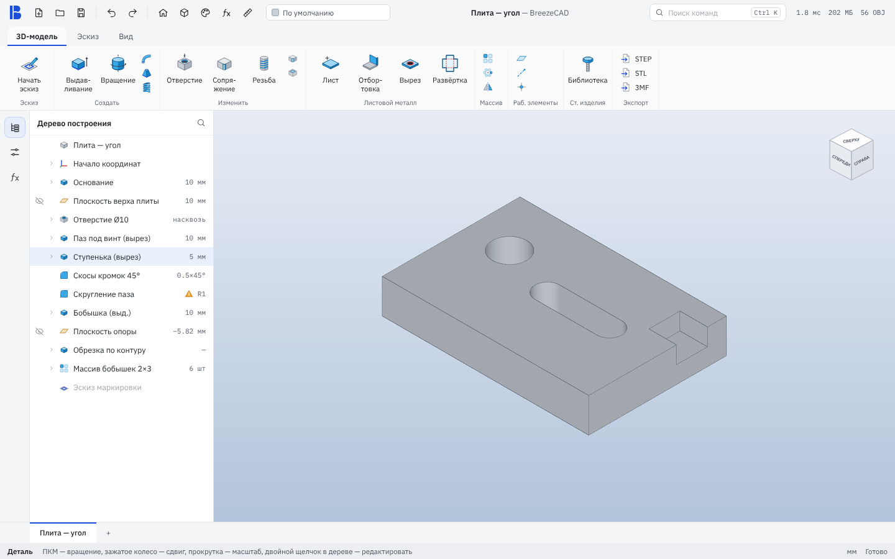
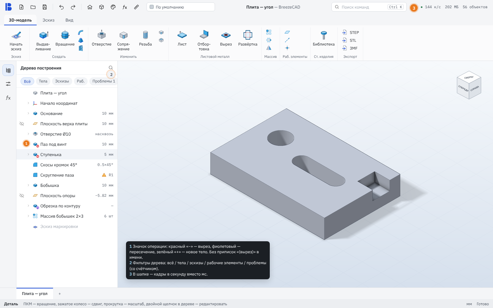

# Дерево и шапка: значки операций, фильтры, кадры в секунду

Статус: **макет на согласование**. Кода программы в ветке нет.

| Сейчас | Предложение |
|---|---|
|  |  |

## 1. Значок операции на иконке узла

Сейчас вырез и добавление выглядят в дереве одинаково (`tree-extrude`), поэтому в именах пишут «(вырез)», «(выд.)».
Предложение — маленький бейдж в правом нижнем углу иконки по `BooleanOp` узла (`SketchSolidFeature`):

| Операция | Бейдж | Цвет (токен) |
|---|---|---|
| Добавить (Join) | нет — обычный случай | — |
| Вырезать (Cut) | «−» | `danger` |
| Пересечь (Intersect) | «∩» | новый `opIntersect` (фиолетовый) |
| Новое тело (NewBody) | «+» | `success` |

Иконки: `icons/badge-cut.svg`, `badge-isect.svg`, `badge-new.svg` (12×12, белая обводка — читаются и на выделенной строке).
Где: `TreePanel.cpp` — `RowStyle` получает `badge`, отрисовка рядом с `style.icon`; `FeatureIcon()` не меняется.
Отверстие всегда вырезает — бейдж ему не нужен. Те же бейджи — в списках операций модулей (`FeatureIcon` там уже используется).

## 2. Фильтры дерева

Строка «Всё · Тела · Эскизы · Раб. · Проблемы N» под заголовком. Только вид: в файл не пишется, держится до закрытия документа.
«Проблемы» показывает узлы с `status-error` / `status-warning` (их уже ставит `TreePanel`) и прячется, когда их нет.
На большой детали (рабочие плоскости занимают треть строк) это быстрее поиска.

## 3. Кадры в секунду вместо мс

Шапка сейчас показывает время работы над кадром («1.8 мс»). Пользователю понятнее «к/с», но есть тонкость: кадр рисуется
только при изменениях, и честное «сколько кадров нарисовано за секунду» в покое — почти ноль. Поэтому показываем
**запас**: `1000 / workMs`, ограниченный частотой монитора, — «144 к/с» (а если запас больше частоты: «144+ к/с»).
Цвета порогов те же (`success` / `warning` / `danger`), подробности в подсказке не меняются. «OBJ» → «объектов».

## Этапы

1. Бейджи операций (самое дешёвое и самое заметное).
2. «к/с» в шапке.
3. Фильтры дерева.

## Нужны решения автора

1. Бейдж для «Добавить» не рисуем — согласен?
2. «144+ к/с» при запасе больше частоты монитора — или просто «144 к/с»?
3. Фильтры — строкой чипов (как на макете) или в меню за значком 🔍?
