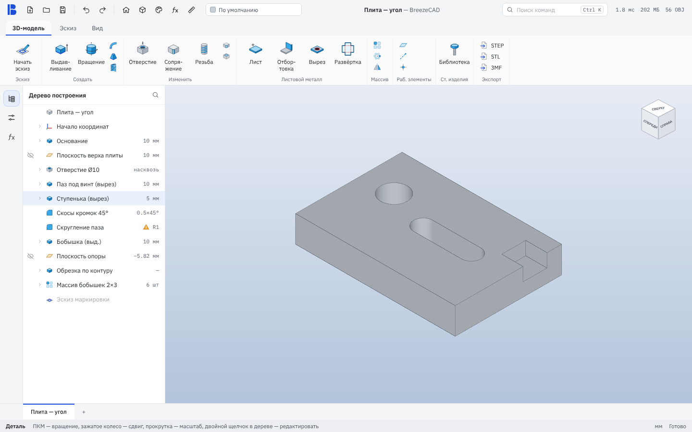
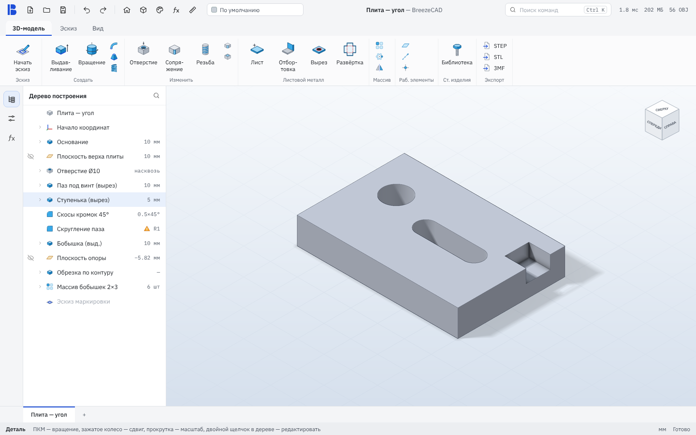
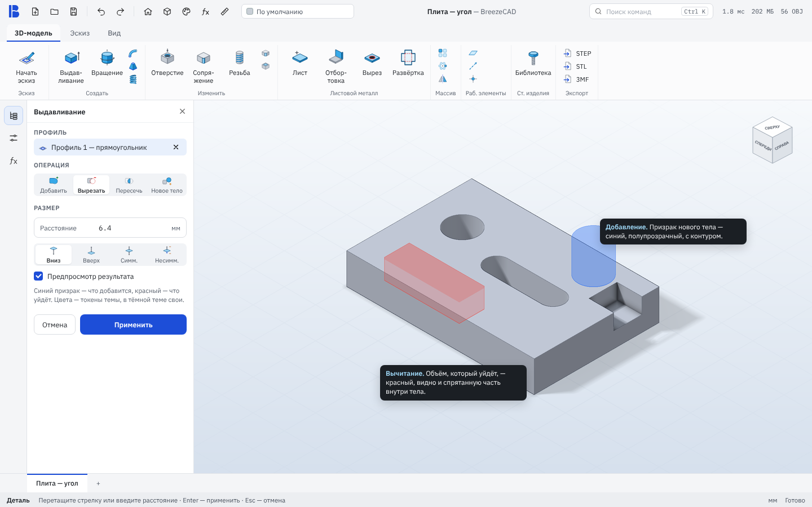
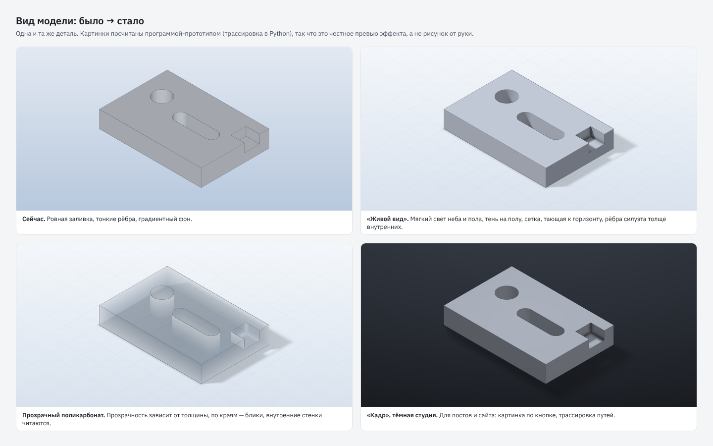

# Вид модели: «Живой вид», предпросмотр операции, прозрачный поликарбонат

Статус: **макет на согласование** (по правилу «новые интерфейсы — сначала макет»). Кода программы в ветке нет.

| Сейчас | «Живой вид» |
|---|---|
|  |  |

Картинки модели посчитаны прототипом `prototype_render.py` (трассировка по полю расстояний на numpy). Это честное превью
эффекта на той же детали, а не рисунок от руки. Окна собраны из настоящих иконок `assets/icons` и токенов светлой темы
(`docs/design/mockup-kit`, пересборка — `bash docs/design/mockup-kit/run.sh`).

## Что предлагается

1. **«Живой вид»** — новый верхний уровень «Качества» (сейчас `Viewport::SetQuality(0..2)` меняет только MSAA и сетку тел):
   - свет неба и пола (PBR + освещение от окружения) вместо «ровной» заливки: грани читаются, на скруглениях появляется объём;
   - мягкая тень от основного света на полу и пол с сеткой, тающей к горизонту — деталь «стоит», а не висит;
   - внешние рёбра (силуэт) толще внутренних — форма видна даже на мелком масштабе.
2. **Предпросмотр операции.** Пока инструмент открыт, его тело показано призраком: **синий** — что добавится, **красный** —
   что уйдёт (и часть, спрятанная внутри тела, просвечивает слабее). Без пересчёта булевой операции — только тело инструмента.
3. **Прозрачный поликарбонат** выглядит как пластик, а не как цветная плёнка: блики по краям, внутренние стенки читаются.

## Цена (оценка, замерить на HP Pavilion i5-4200U / HD 4400)

| Уровень | Что включено | Нагрузка | Видеопамять |
|---|---|---|---|
| Экономный / Обычный | как сейчас + силуэтные рёбра + предпросмотр | +0–5 % | ~0 |
| **Живой вид** | + PBR, окружение, тень, пол | −30…50 % к/с на HD 4400, на дискретной незаметно | +~16 МБ (карта теней 2048²) + ~4 МБ (окружение) |

Вес программы — без изменений: всё нужное уже есть в OCCT (TKOpenGl), окружение генерируется из градиента, файлов не надо.
На Android/iOS «Живой вид» по умолчанию выключен.

## Как сделать на OCCT 8.0.1 (имена API сверить по заголовкам)

- **PBR + окружение:** `view->SetShadingModel(Graphic3d_TypeOfShadingModel_Pbr)` только на уровне «Живой вид»;
  материалы — `Graphic3d_PBRMaterial` из `doc::Finish` (металл: metallic≈1, roughness≈0.35; пластик: 0 / 0.5; стекло — см. ниже).
  Окружение: кубическая карта, собранная в памяти из двух цветов темы (`viewportTop` / новый токен `envGround`),
  `view->SetBackgroundCubeMap(cube, true)` + `SetImageBasedLighting(true)`; сам фон оставляем градиентом.
  PBR требует корректного sRGB — уровни света в `SetUpLights` (подобраны вручную под 0.84 / 0.70 / 0.58) придётся
  перенастроить отдельно для этого уровня.
- **Тень:** у ключевого `V3d_DirectionalLight` — `SetCastShadows(true)`, `ShadowMapResolution = 2048`, подобрать `ShadowMapBias`.
  Пол — большая плоскость под габаритом тела (z = min − 0,01 мм) цвета `viewportBottom`, с прозрачностью к краям.
  **Риск:** в OCCT нет готового «ловца теней»; если пол на фоне градиента будет заметен как плоскость — делаем его текстурой
  с альфой, затухающей по радиусу (как в прототипе).
- **Сетка пола:** та же плоскость, текстура-сетка с затуханием; шаг — от масштаба, как у сетки эскиза.
- **Силуэт:** `Graphic3d_Aspects::SetDrawSilhouette(true)` у тонированных презентаций, внутренние рёбра (FaceBoundary) — тоньше.
- **Предпросмотр:** отдельный `AIS_Shape` с телом инструмента (призма/тело вращения профиля), токены `previewAdd` / `previewCut`,
  прозрачность ~0.6; невидимая часть — второй слой `Graphic3d_ZLayerSettings` с выключенным тестом глубины и прозрачностью ~0.8.
- **Поликарбонат:** на уровне «Живой вид» — `Graphic3d_RTM_BLEND_OIT` вместо `BLEND_UNORDERED` (сейчас сознательно выключено ради
  скорости, поэтому только здесь) + френель от PBR. Поглощение по толщине — только в «Кадре» (трассировка, `Graphic3d_BSDF`).
- **Затенение в углах (AO)** в растеризации OCCT нет. Если захочется в «Живом виде» — свой постпроход по глубине,
  отдельный этап и только для дискретных видеокарт. В «Кадре» AO получается само.

Цвета — только новые токены темы (светлая и тёмная): `previewAdd`, `previewCut`, `envGround`, `floorShadow`, `floorGrid`.
Форматы файлов, CMake, `.github/` не трогаются.

## Этапы

1. Силуэтные рёбра + токены предпросмотра — дёшево, на всех уровнях.
2. Предпросмотр операции (выдавливание, вращение, отверстие, массив).
3. Уровень «Живой вид»: PBR + окружение + перенастройка света.
4. Тень и пол с сеткой.
5. OIT для прозрачных материалов на «Живом виде».
6. (по желанию) свой AO-постпроход.

## Нужны решения автора (одним пакетом)

1. «Живой вид» включать по умолчанию, если видеокарта дискретная (на встроенной — «Обычный»)?
2. Пол и сетка — только в «Живом виде» или переключателем «Пол и сетка» на вкладке «Вид» на всех уровнях?
3. Цвета призраков: синий / красный, как на макете?
4. Порядок этапов — как выше, или начать с предпросмотра (польза для работы) раньше красоты?
